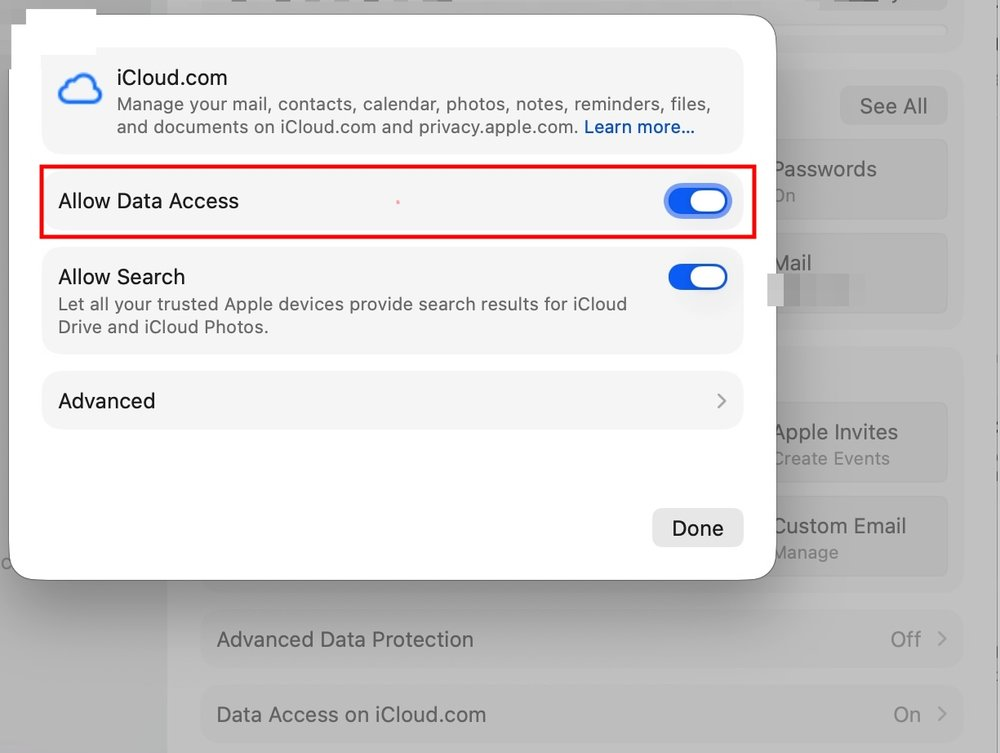

# FAQ

Answers to problems people have reported. If yours is not here, [open an issue](https://github.com/lroolle/ihme-cli/issues/new/choose).

## Signed in, but Hide My Email refuses the session

`ihme auth login` gets through the password and two-factor step, then fails with:

```
Error: iCloud signed you in, but Hide My Email refuses this session
  Cause: listing HME: iCloud accepted the session but Hide My Email refused it: HTTP 401 from https://p50-maildomainws.icloud.com/v2/hme/list: {"reason":"Invalid global session","error":2}
```

Before 0.7.1 the same problem showed as `HTTP 401 ... Invalid global session` with the advice to sign in again, which never helped.

iCloud accepted your sign-in, but your account blocks access to iCloud data from the web, and ihme talks to the same web API as icloud.com. Turn on **Allow Data Access**, then run `ihme auth login` again.

iPhone or iPad, iOS or iPadOS 26.4 or later:

1. Settings > [your name] > iCloud > iCloud.com
2. Turn on Allow Data Access.

Mac, macOS 26.4 or later:

1. Apple menu > System Settings > [your name] > iCloud > Data Access on iCloud.com
2. Turn on Allow Data Access.



Earlier versions call it **Access iCloud Data on the Web**, directly under Settings (or System Settings) > [your name] > iCloud.

Turning on Advanced Data Protection switches this setting off without asking, so check it after you change ADP. With ADP on, Apple also asks a trusted device to approve web access; ihme has not been tested in that state. Apple's article: [Manage web access to your iCloud data](https://support.apple.com/102630).

This error exits with code 1, not 2: signing in again does not fix it, only the setting does. Reported in [#14](https://github.com/lroolle/ihme-cli/issues/14).

## No two-factor code arrives

If your Apple Account uses security keys, Apple sends no code. Use ihme 0.7.1 or later (`ihme version`): it asks you to plug a FIDO2 key into USB and touch it. Keys that demand a PIN on every use, U2F-only keys, NFC and Bluetooth are not supported yet. Platform notes are in the [command guide](usage.md#authentication-and-errors).

## Cleaning up old addresses

ihme 0.7.4 or later. List the oldest first; the first column is each address's ID:

```
ihme list --sort date:asc
```

Pass several IDs (or full addresses) at once:

```
ihme deactivate 7d8e9f0a 3f9a1b2c
ihme delete --force 7d8e9f0a 3f9a1b2c
```

Deactivating stops an address's mail, and `ihme reactivate` brings it back. Deleting is permanent. If an address is still the sign-in email for some account, deleting it means that account's password-reset mail has nowhere to go. When unsure, deactivate first and delete later.

`delete` lists every address and asks once. `ihme export --sort date:asc -o addresses.csv` gives the same list for a spreadsheet.

## When was an address last used?

Apple does not record it anywhere ihme can read. For each address, Hide My Email returns its creation date, label, note, forward-to address, and whether it is active. Nothing about the mail it received.

To check whether an address still gets mail, search the inbox it forwards to for the address.

## "Apple reports no Hide My Email on this Apple Account"

Hide My Email needs an iCloud+ subscription on the Apple Account you signed in with. Check Settings > [your name] > iCloud > Hide My Email on an iPhone.
